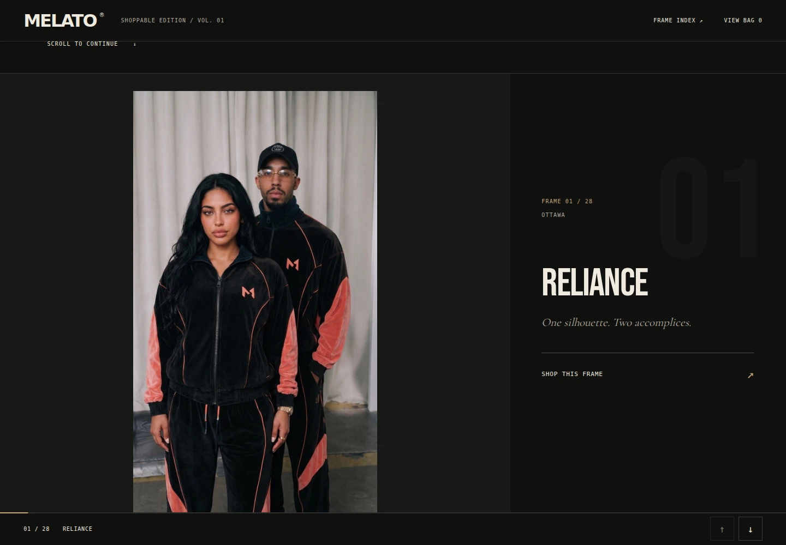
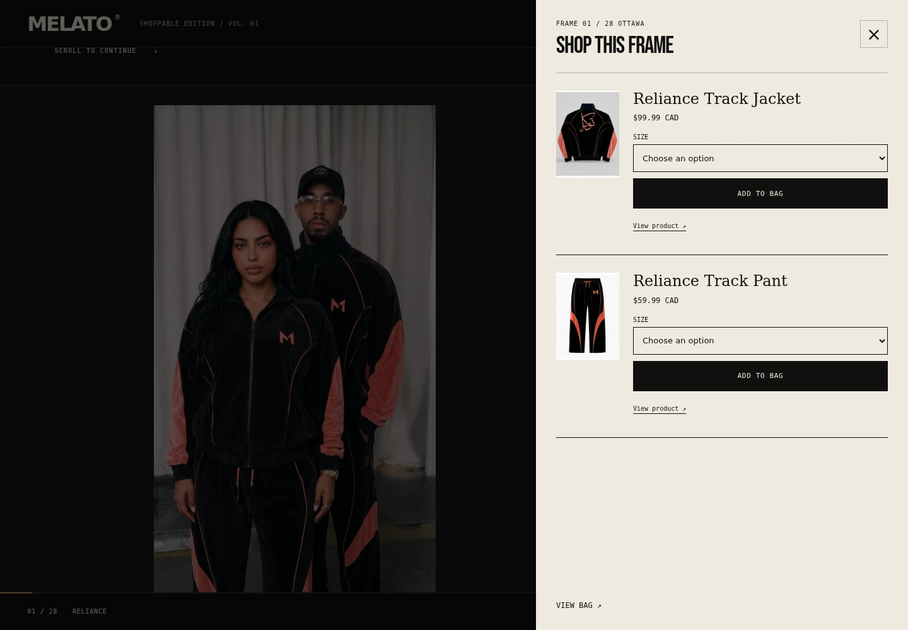
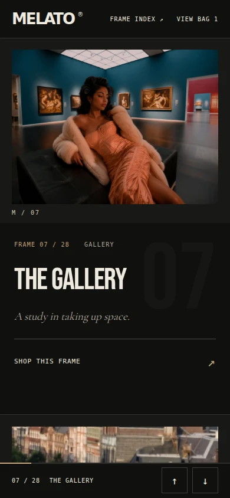
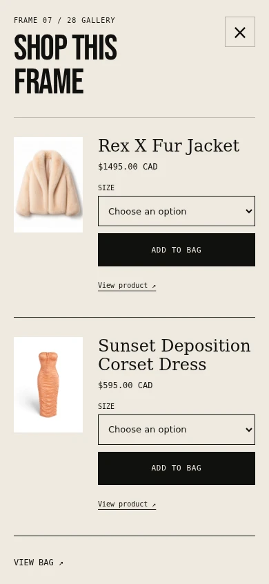

# The Living Lookbook: Codex audition

The 28-frame reference now drives a shoppable editorial reader at the existing Living Lookbook route. Each frame retains its original artwork and sequence. Twenty frames identify products, eight remain narrative, and nineteen distinct products are referenced by exact handle.

## Experience

- Black, cream and bronze editorial treatment, locally hosted condensed typography, full uncropped artwork.
- Native scrolling, frame index, previous/next navigation, progress and deep links such as `#frame-07`.
- A cream shopping panel for the pieces in the current frame. Product links remain direct and exact.
- Shopify product settings resolve published product objects at render time. Product titles, images, current market prices, variant choices and availability come from those objects. No snapshot prices or inventory rules ship in the client.
- Select the actual sellable variant, add it to the Shopify cart, then keep reading. An in-flight guard prevents duplicate clicks. Errors retain the selection. A successful add stays successful if the cart-count refresh fails.
- Without JavaScript, all frames render, shopping panels open as native details elements, and product forms submit to Shopify normally.
- Native modal focus handling and Escape, visible focus, reduced motion, translated English/French interface, and scoped theme editor initialization/unload.
- All frames and both product references are editable in the Shopify theme editor. Previous lookbook assets remain available in the repository but are not loaded by this template.

## Source reconciliation

The supplied text is a creative reference, not a current stock feed. Read-only checks against connected Shopify and the public storefront on 2026-11-08 verified all nineteen product URLs. Sunset Deposition, Dawn-to-Dusk and Taqburni are published, so this edition uses their exact product pages rather than stale unavailable flags.

Two source filenames contain an extra underscore. The working originals are `Melato.ca_EL_TLL_FRAME_105.jpg` and `Melato.ca_EL_TLL_FRAME_106.png`. Both return HTTP 200; the double-underscore versions return 404. Frame 14 uses `The_Living_Lookbook_Editorial_Shots_Vol2_5.jpg`, recovered from the existing book and visually matched to the reference. The tie is Vol2_26. The checked-in `../living-lookbook-frame-manifest.json` records the entire sequence and product assignments.

## Verification

- `npm test`: 79 passed, 0 failed, including eight behavioral/sequence tests.
- `node scripts/validate-melato-product-page-bible.mjs`: passed.
- Shopify theme validator: new section, product snippet, stylesheet, controller, JSON template and English locale passed. French has 84 pre-existing missing translation keys elsewhere in the theme. All 27 new lookbook keys are present in both languages. These unrelated locale gaps were preserved rather than expanding this audition's scope.
- Browser rendering at 1440×1000 and 390×844: 28 frames, no JavaScript errors, no mobile horizontal overflow, correct two-product gallery panel. Browser add-to-cart was exercised against a mocked Shopify response, alongside the unit tests for variant selection, rejected carts and repeated clicks. No real customer cart, order or inventory was modified.
- All 28 editorial image URLs and all 19 product endpoints returned HTTP 200 after the two filename corrections.
- `git diff --check`: passed.

Screenshots below are from a local Liquid-rendered fixture with verified source images and catalogue data. They demonstrate the implementation, not a deployed Shopify theme. Artwork was cached locally for browser testing because the standalone browser does not inherit the environment's HTTP proxy.

## Review and rollout

This branch replaces only `templates/page.living-lookbook.json` plus its new component assets and translations. It does not publish a theme or change Shopify products. Next, compare this audition with the other candidates in an unpublished Shopify theme preview, including the store's full global styling and live cart behavior. Merge and live publication remain owner decisions. Reverting the template restores the previous reader.

Bebas Neue is bundled under the SIL Open Font License in `../BEBAS-NEUE-OFL.txt`.

Codacy follow-up: [MDP-74 through MDP-88 remediation and verification](codacy-MDP-74-88.md).
